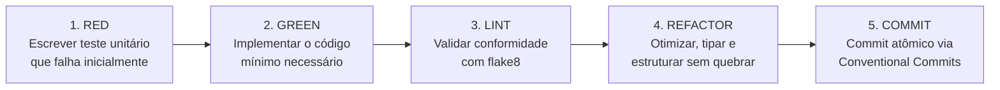

# Regra de Engenharia: Padrões de Código, TDD e Workflow de Execução

> **Escopo da Regra:** Exclusiva deste projeto (`homelab`).  
> **Aplicação:** Mandatória para qualquer sessão, agente de IA, pipeline ou desenvolvedor atuando na implementação de código neste repositório.

---

## 1. Ciclo de Desenvolvimento TDD (Test-Driven Development)

O Homelab adota o **ciclo TDD formal** utilizando exclusivamente o framework nativo **`unittest`** do Python 3 ([`testing-and-infra-lifecycle.md`](testing-and-infra-lifecycle.md)).



### Diretrizes Estritas do TDD:
1. **Testes Antes ou Junto com o Código:** Nenhuma classe, função ou contrato novo deve ser mesclado sem a criação simultânea de casos de teste em `tests/`.
2. **Framework Exclusivo `unittest`:** Proibido o uso ou menção a `pytest`. Utilize sempre classes herdando de `unittest.TestCase`.
3. **Não-Regressão Obrigatória:** Toda alteração deve ser validada contra a suíte completa de testes (`python3 -m unittest discover -s tests -v`) antes de qualquer commit.

---

## 2. Linting Estático e Conformidade PEP 8 (`flake8`)

O repositório adota o **`flake8`** como linter estático oficial, configurado através do arquivo canônico [`.flake8`](file://.flake8) na raiz do projeto.

### Regras de Linting:
- **Limite de Linha:** `max-line-length = 100`. Oferece equilíbrio entre telas modernas e terminais compactos (Termux/SSH).
- **Complexidade Ciclomática:** Limite de complexidade ciclomática em `max-complexity = 12`. Funções que ultrapassem esse limite devem ser decompostas.
- **Ignorados Padronizados:** `E203` (espaço antes de dois pontos em fatiamentos) e `W503` (quebra de linha antes de operador binário), para alinhamento com os padrões modernos de formatação PEP 8.
- **Validação Automatizada:** Utilize o script auxiliar [`scripts/run-lint.sh`](file://scripts/run-lint.sh) ou o comando `flake8 app/ tests/` antes de concluir qualquer tarefa de código.

---

## 3. Diretrizes de Arquitetura Cliente-Servidor Orientada a Objetos (OO)

A camada de software do Homelab baseia-se no **Princípio da Responsabilidade Única (SRP)** e no paradigma orientado a objetos:

1. **Separação Rígida de Camadas:**
   - **Camada de Rede/Transporte:** Classes de serviço (`HomelabServer`, `ControlServer`, `DataServer`, `HomelabClient`) encapsulam sockets, listeners, buffers e ciclo de vida de conexão.
   - **Camada de Protocolo/Framing:** Classes e codecs (`Message`, `MediaChunk`, `ProtocolCodec`) realizam serialização e deserialização binária de forma pura, sem dependência de sockets ou arquivos.
   - **Camada de Sessão e Autenticação:** Classes especializadas (`SessionStore`, `ClientRepository`) gerenciam chaves HMAC, tokens de upload e persistência SQLite.
2. **Gerenciamento do Débito Técnico Legado:**
   - Divergências existentes no código funcional/procedural estão formalizadas no inventário [`docs/debts.md`](../../docs/debts.md).
   - Qualquer nova funcionalidade deve nascer estritamente orientada a objetos. Refatorações do código legado devem seguir a matriz de priorização de débitos técnicos.

---

## 4. Governança de Exceções de Domínio

### Proibições Absolutas:
- **NUNCA** utilize blocos `except Exception: pass` ou capturas genéricas desprovidas de tratamento e contexto.
- **NUNCA** lance `raise Exception("mensagem genérica")`.

### Hierarquia Oficial de Exceções ([`app/exceptions.py`](file://app/exceptions.py)):
Todas as exceções do projeto devem derivar da classe raiz `HomelabError`:

```text
HomelabError (Base)
├── ProtocolError (Erros de framing, tamanho inválido ou magic bytes)
│   └── HMACVerificationError (Assinatura HMAC corrompida ou chave incorreta)
├── AuthenticationError (Credenciais inválidas ou usuário inexistente)
│   └── SessionExpiredError (Token/chave de sessão expirada)
├── StorageError (Falhas de persistência SQLite ou I/O em disco)
└── NetworkTimeoutError (Timeouts de socket em handshake ou streaming)
```

### Contextualização de Mensagens de Erro:
Ao registrar ou levantar uma exceção, inclua sempre os metadados contextuais:
- Endereço e porta do cliente (`client_ip:client_port`).
- Identificador do usuário autenticado.
- Valores esperados versus valores recebidos (ex: bytes de framing ou SHA-256).

---

## 5. Sanitização e Mascaramento de Dados Sensíveis

O Homelab adota **política de vazamento zero** para credenciais, chaves e dados sensíveis:

1. **Dados Estritamente Confidenciais:**
   - Senhas de usuários em texto puro.
   - Hashes completos de senhas (PBKDF2/SHA256).
   - Chaves de sessão dinâmicas (HMAC secrets emitidos no handshake).
   - Tokens de upload e sessões de clientes.
2. **Regra de Mascaramento Mandatória:**
   - É terminantemente proibido exibir dados confidenciais completos em:
     - Saídas de terminal (`print` ou `stdout`).
     - Arquivos de log (`app/logs/*.log`).
     - Mensagens de retorno ou pacotes de erro de rede.
   - Utilize funções de mascaramento seguro (`mask_secret`):
     - Senhas: `***` ou `[REDACTED]`.
     - Hashes e chaves HMAC: apenas os primeiros e últimos 4 caracteres (ex: `1a2b...9z8y`), ou `[SESSION_KEY_ACTIVE]`.

---

## 6. Boas Práticas Complementares de Engenharia

1. **Tipagem Estática Obrigatória (Type Hints - PEP 484 / 526):**
   - Assinaturas de classes, métodos públicos e funções devem ter anotações explícitas de argumentos e retornos.
2. **Gerenciamento Determinístico de Recursos (Context Managers & RAII):**
   - Conexões de banco SQLite e sockets devem ser obrigatoriamente gerenciados via `with` ou blocos `try...finally: close()`, prevenindo alertas de `ResourceWarning` e esgotamento de descritores no Android (`ulimit -n`).
3. **Timeouts Mandatórios em Sockets:**
   - Todo socket de cliente ou servidor deve configurar timeout explícito (`sock.settimeout(10.0)`), evitando threads penduradas indefinidamente no sistema.
4. **Substituição de `print()` por `logging` Nativo:**
   - O uso de `print()` é restrito aos prompts da CLI do cliente. Código de servidor, banco e protocolo deve usar o módulo `logging` nativo formatado.
5. **Graceful Shutdown:**
   - Classes de servidor devem interceptar interrupções de processo (`SIGINT`, `SIGTERM`, `KeyboardInterrupt`) e implementar métodos `stop()` e `close()` para liberar portas e fechar canais de forma limpa.
