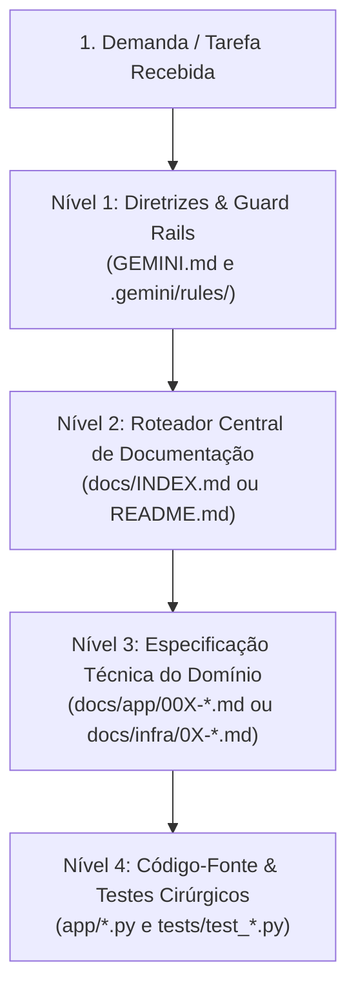

# Regra de Desenvolvimento: Navegação de Contexto e Documentação (Docs-First)

> **Escopo da Regra:** Exclusiva deste projeto (`homelab`).  
> **Aplicação:** Mandatória para qualquer sessão, agente de IA ou desenvolvedor atuando neste repositório.

---

## 1. Princípio Fundamental: Docs-First (Documentação Antes do Código)

Ao receber um novo objetivo, problema para investigar ou tarefa de desenvolvimento, **é expressamente proibido sair vasculhando o código-fonte (`app/*.py`, `scripts/`) às cegas ou executando buscas globais extensas sem contexto**.

O projeto Homelab é altamente documentado. Toda arquitetura, protocolo, decisão técnica e contrato de dados possui uma especificação formal em `docs/`. Portanto, **a busca por respostas e contexto deve sempre começar pela documentação técnica**.

---

## 2. Hierarquia Obrigatória de Exploração de Contexto

Toda interação ou tarefa deve seguir a seguinte ordem de leitura em camadas:

### Nível 1: Diretrizes e Guard Rails do Projeto
- Consultar [`GEMINI.md`](../../GEMINI.md) e as regras em `.gemini/rules/` para identificar:
  - Restrições da branch ativa.
  - Guard rails de escopo estrito e proteção contra mutações indevidas.

### Nível 2: Roteador Central de Documentação (`docs/INDEX.md`)
- Em vez de adivinhar quais arquivos existem, consulte o **Roteador Temático** em [`docs/INDEX.md`](../../docs/INDEX.md).
- Localize o domínio da sua tarefa (ex: Sockets, Uploads em Chunks, Autenticação, Configurações de Ambiente, Infraestrutura no Celular).
- O roteador fornecerá diretamente:
  - O documento técnico canônico.
  - Os arquivos de código correspondentes.
  - As suítes de testes relacionadas.

### Nível 3: Especificação Técnica do Domínio
- Ler o documento técnico identificado em `docs/app/` ou `docs/infra/`.
- Extrair da documentação:
  - Constantes, portas, tipos de mensagens e contratos de rede.
  - Classes e responsabilidades orientadas a objetos.
  - Comportamento esperado e regras de negócio.

### Nível 4: Leitura e Edição Cirúrgica de Código
- Somente após dominar a especificação do Nível 3, abrir os arquivos de implementação em `app/` ou `scripts/`.
- Utilizar buscas pontuais (`git grep -n "termo" <arquivo>` ou leitura direcionada por linhas/símbolos).

---

## 3. Práticas Proibidas (Anti-Patterns)

- ❌ **Varredura Cega:** Fazer `grep` recursivo na raiz do repositório procurando palavras genéricas antes de ler a documentação.
- ❌ **Leitura em Massa:** Abrir simultaneamente todos os arquivos de `app/` para tentar entender a lógica por engenharia reversa.
- ❌ **Alteração sem Especificação:** Modificar constantes, assinaturas de métodos ou fluxos sem antes verificar se a mudança viola a especificação documentada no módulo correspondente.
