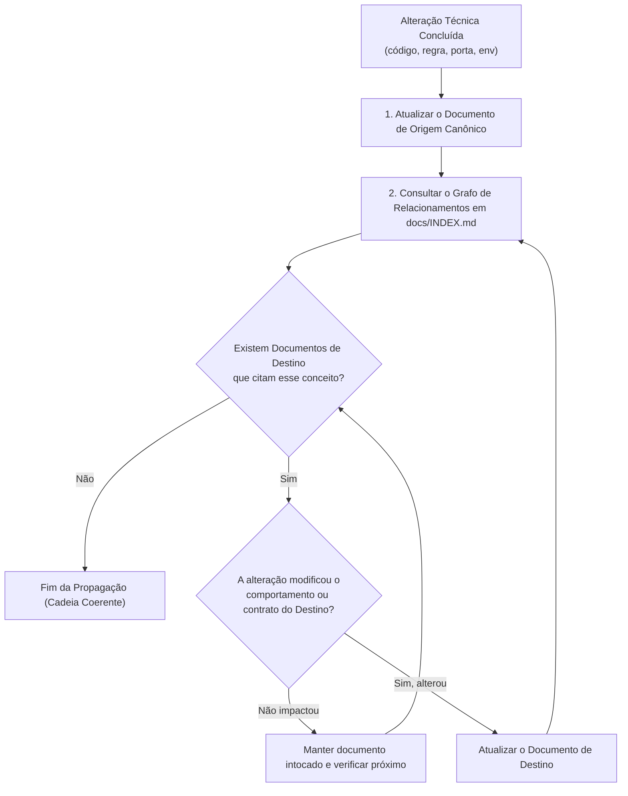

# Regra de Manutenção: Ciclo de Propagação e Rastreamento de Documentação

> **Escopo da Regra:** Exclusiva deste projeto (`homelab`).  
> **Aplicação:** Mandatória para qualquer sessão, agente de IA ou desenvolvedor atuando neste repositório.

---

## 1. Princípio da Integridade Documental e Relacionamentos

No projeto Homelab, o código reflete a documentação e a documentação reflete o código. Quando uma alteração afeta contratos, comportamentos, variáveis de ambiente, portas de rede, classes OO ou fluxos de execução, **é obrigatório auditar e propagar essa modificação para toda a cadeia de documentos dependentes**.

---

## 2. Conceito de Documentos de Origem e Destino

Toda alteração de arquitetura ou regra envolve dois papéis documentais:

1. **Documento de Origem (Source):** O módulo técnico onde a funcionalidade é especificada formalmente pela primeira vez (ex: [`docs/app/004-protocolos-controle-e-dados.md`](../../docs/app/004-protocolos-controle-e-dados.md) para framing TCP de 40B).
2. **Documentos de Destino (Consumers / Targets):** Todos os documentos técnicos, resumos, tabelas de portas, READMEs ou arquivos de regras que citam, consomem ou dependem daquele conceito.

---

## 3. Algoritmo de Propagação em Cascata

Ao concluir uma alteração técnica, siga rigorosamente o seguinte fluxo de auditoria:

### Regras do Algoritmo:
1. **Identificar o Impacto Real:** Uma atualização só deve ser propagada para o próximo documento se o comportamento descrito nele tiver sido modificado. Se a menção for puramente genérica e permanecer válida, o arquivo não deve ser editado (evitando poluição de diffs).
2. **Iteração Contínua:** Enquanto houver documentos afetados pela alteração na cadeia de dependências, continue atualizando um a um.
3. **Ponto de Parada Determinístico:** A propagação cessa assim que todos os documentos diretamente ou indiretamente impactados pelo novo comportamento forem sincronizados.
4. **Fechamento no `README.md`:** O `README.md` é a vitrine do repositório. Toda alteração que adicione novos módulos (`docs/`), novas portas ou novas ferramentas principais deve ter seu reflexo final no `README.md`.
