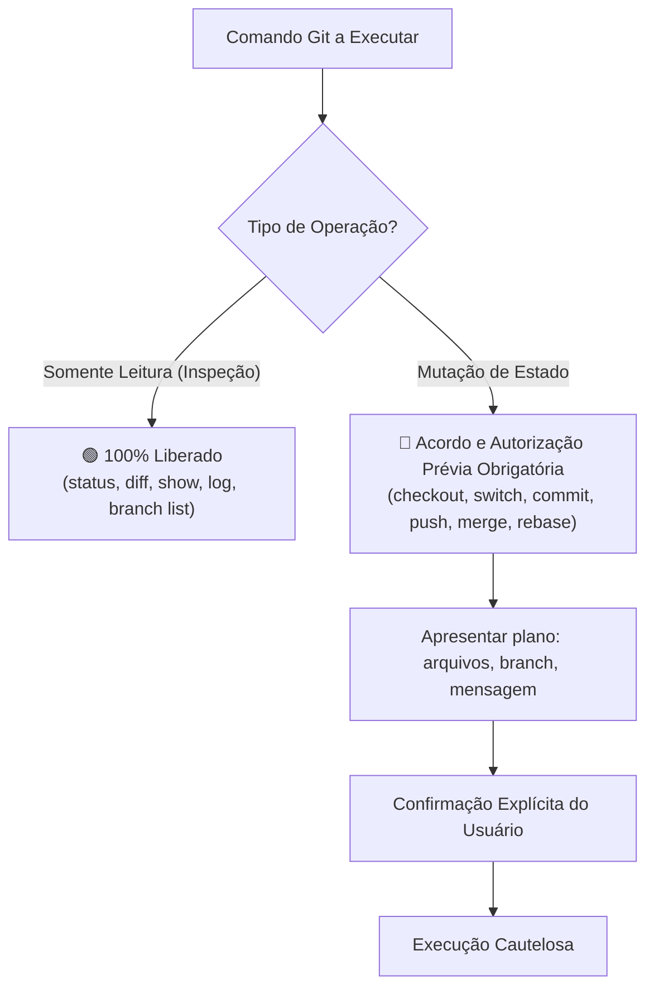

# Regra de Governança: Matriz de Permissões e Guard Rails de Execução Git

> **Escopo da Regra:** Exclusiva deste projeto (`homelab`).  
> **Aplicação:** Mandatória para qualquer sessão, agente de IA, script ou desenvolvedor atuando neste repositório.

---

## 1. Princípio de Separação de Comandos Git

Para garantir total previsibilidade e segurança, os comandos Git são categorizados estritamente entre **Operações de Inspeção (Somente Leitura)** e **Operações de Mutação de Estado**.

---

## 2. Comandos de Inspeção (Somente Leitura) — 🟢 100% Liberados

O agente de IA e os desenvolvedores possuem permissão total para executar comandos de leitura a qualquer instante para diagnosticar o estado do repositório, inspecionar diffs e verificar históricos:

| Comando | Finalidade Autorizada |
| :--- | :--- |
| `git status` | Verificar arquivos modificados, staged e untracked |
| `git diff` / `git diff --staged` | Revisar alterações antes de propor commits |
| `git show` | Inspecionar detalhes de commits específicos ou tags |
| `git log` | Consultar histórico de commits e linearidade da árvore |
| `git branch` (sem flags de exclusão) | Listar branches locais e remotas |
| `git worktree list` | Mapear worktrees ativas no ambiente |
| `git ls-files` | Consultar arquivos rastreados no índice |

---

## 3. Comandos de Mutação de Estado — 🛑 Exigem Acordo Prévio

**NENHUM comando que altere branches, commits, índice ou histórico pode ser executado no automático sem alinhamento e consentimento explícito do usuário:**

| Comando de Mutação | Requisito Obrigatório Antes da Execução |
| :--- | :--- |
| `git checkout` / `git switch` | Informar a branch de origem, a branch de destino e obter o aval do usuário. |
| `git branch <nova-branch>` | Alinhar o nome padronizado da branch conforme o objetivo (`feat/`, `chore/`, etc.). |
| `git branch -d` / `-D` | Exposição clara do motivo da exclusão e autorização explícita. |
| `git commit` | Apresentar previamente o checklist da Action e a mensagem no formato **Conventional Commits**. |
| `git merge` | Detalhar a estratégia de integração e aguardar validação dos testes. |
| `git rebase` | Confirmar que a base está limpa e que o usuário aprovou a sincronização. |
| `git push` | Confirmar a branch remota de destino e permissões de envio. |
| `git reset` / `git stash` | Risco de perda de dados: somente sob solicitação expressa do usuário. |

---

## 4. Diretriz de Conflitos: Resolução Manual

- **Proibição de Forçamento Automático:** É terminantemente proibido utilizar flags como `--ours`, `--theirs`, `-Xtheirs` ou estratégias de resolução automática sem análise humana.
- **Procedimento em Caso de Conflito:**
  1. Interromper imediatamente qualquer operação destrutiva.
  2. Apresentar os arquivos em conflito e os blocos divergentes ao usuário.
  3. Definir a resolução em conjunto com o usuário antes de concluir o merge/rebase.

---

## 5. Proteção da Branch `main`

Permanece ativa e inegociável a regra documentada em [`.gemini/rules/commit-rules.md`](commit-rules.md):
- **NUNCA realizar commits diretos na branch `main`.**
- Toda alteração deve ser desenvolvida em branch própria e integrada via merge aprovado.
