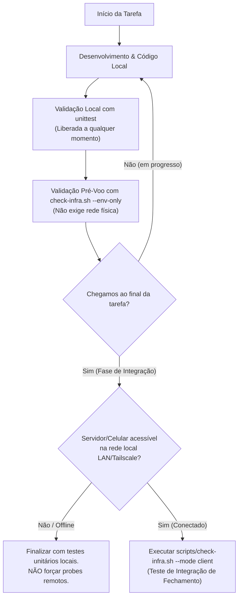

# Regra Técnica: Ciclo de Vida de Testes e Comandos de Infraestrutura

> **Escopo da Regra:** Exclusiva deste projeto (`homelab`).  
> **Aplicação:** Mandatória para qualquer sessão, agente de IA, pipeline ou desenvolvedor atuando neste repositório.

---

## 1. Padrão Exclusivo de Testes de Código: `unittest`

O Homelab adota como premissa arquitetural a utilização da **biblioteca padrão do Python 3 com zero dependências externas desnecessárias** ([`docs/app/002-stack-definicao-e-arquitetura.md`](../../docs/app/002-stack-definicao-e-arquitetura.md)).

### Diretrizes Estritas:
1. **Framework Único Homologado:** O único executor oficial de testes é o **`unittest`** nativo do Python 3.
2. **Proibição de Ferramentas Externas:** **NUNCA** execute, busque ou tente configurar `pytest`, `nosetests` ou outros runners externos no repositório, a menos que haja solicitação explícita do usuário.
3. **Execução Liberada:** Comandos de execução de testes com `unittest` são considerados ferramentas de garantia de qualidade e estão **100% liberados para execução automática** antes de commits e validações.

### Comandos Canônicos de Teste:
```bash
# Executar a suíte completa de testes:
python3 -m unittest discover -s tests -v

# Executar suíte específica:
python3 -m unittest tests/test_dual_protocol_and_chunks.py -v
python3 -m unittest tests/test_auth_and_session.py -v
python3 -m unittest tests/test_config.py -v
python3 -m unittest tests/test_check_infra.py -v
```

---

## 2. Ciclo de Vida dos Comandos de Infraestrutura

Comandos de infraestrutura referem-se a operações que interagem com o hardware físico do smartphone (Xiaomi Redmi Note 9S), ambiente Debian 11/UserLAnd, portas de rede remotas, SSH ou scripts do diretório `scripts/` (ex: `scripts/check-infra.sh`, `battery-guard.sh`, conexões TCP no IP do celular `192.168.0.246`).



### Regras de Execução de Infraestrutura:
1. **Proibição no Início e Meio do Ciclo:** É proibido tentar disparar testes de rede contra o celular ou tentar checar status do hardware no início ou durante a edição de código/regras. O foco inicial deve ser puramente local.
2. **Execução Apenas no Fechamento:** Comandos que disparam requisições de rede ao host remoto (`--mode client`, ping, probes TCP nas portas 9000/9001 e SSH) devem ser executados **exclusivamente na etapa final de fechamento da branch/tarefa**.
3. **Condição Mandatória de Conectividade:** Só executar probes remotos se o usuário ou o ambiente confirmar que o celular está ativo e acessível na rede. Se o host estiver offline, o agente deve encerrar a validação nos testes unitários e modo `--env-only`, sem travar ou gerar erros por timeout de rede.
