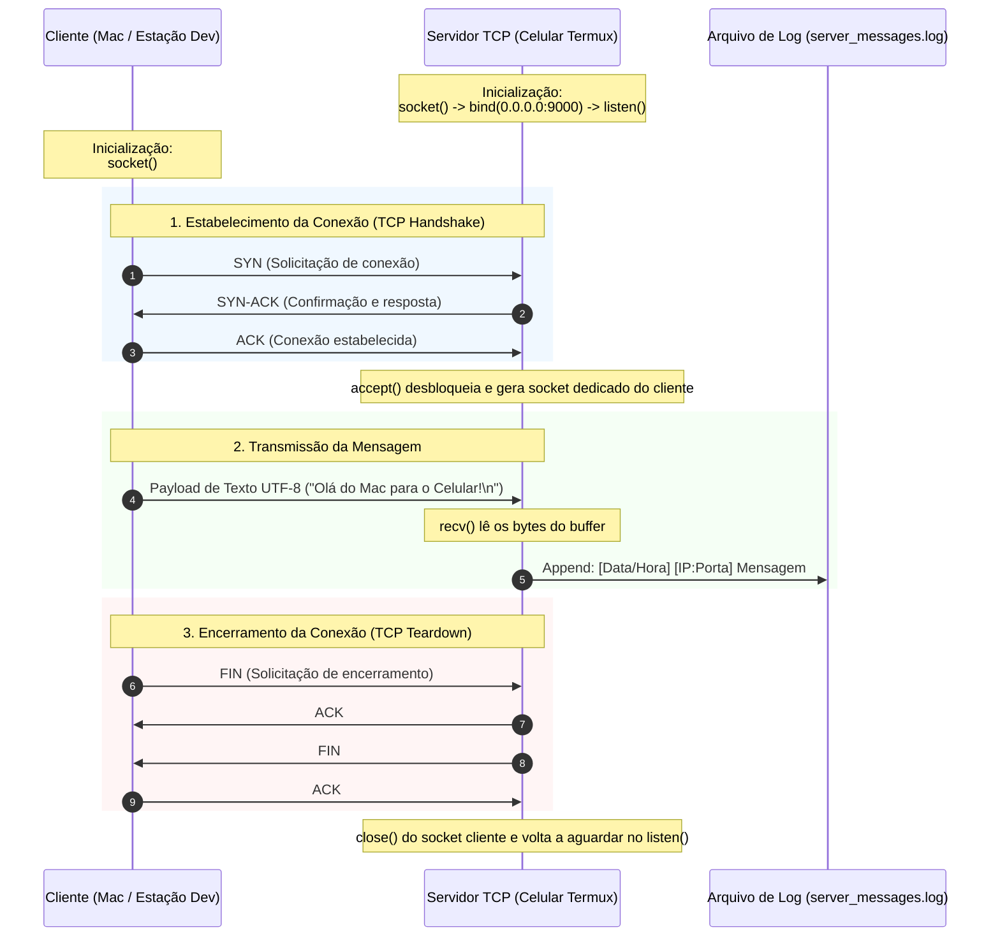

# Documento Técnico: Conexão TCP via Sockets e Persistência de Logs

> **Objetivo:** Documentar o funcionamento e a especificação da próxima etapa do projeto — o estabelecimento de uma comunicação via socket TCP entre cliente e servidor, com persistência de mensagens de texto recebidas em um arquivo de log no celular.
>
> **Nota de Escopo:** Este documento serve como especificação e guia conceitual de implementação. Nenhuma linha de código de produção foi adicionada neste estágio.

---

## 1. Visão Geral e Propósito Educativo

Com o ambiente do servidor básico já inicializado no smartphone (Redmi Note 9S rodando Termux), o próximo objetivo prático é entender como funciona a **comunicação de rede em baixo nível (Camada de Transporte / Camada 4 do modelo OSI)** usando sockets TCP puros.

### O que vamos construir conceitualmente:
1. **Lado do Servidor (Celular / Termux):**
   - Abre um socket de rede TCP.
   - Faz o *bind* em uma porta alta (ex: `9000`) e escuta conexões passivas (*listen*).
   - Ao receber uma conexão (*accept*), recebe a mensagem em texto puro enviada pelo cliente.
   - Salva a mensagem recebida juntamente com metadados (timestamp, IP e porta do cliente) em um arquivo de log local (`server_messages.log`).
   - Fecha ou mantém o socket conforme a política de sessão.

2. **Lado do Cliente (Computador / Mac / Outro terminal):**
   - Cria um socket TCP.
   - Conecta-se ativamente ao endereço IP do celular na rede local (ex: `192.168.1.X:9000`).
   - Transmite uma mensagem de texto codificada em UTF-8.
   - Encerra a conexão ordenadamente.

---

## 2. Conceitos Fundamentais de Redes

### 2.1. O que é um Socket?
Um socket é uma abstração do sistema operacional que representa um ponto de extremidade (*endpoint*) para envio ou recebimento de dados através de uma rede. Ele é identificado pela tupla:
$$\text{Socket} = (\text{Endereço IP}, \text{Porta}, \text{Protocolo})$$

### 2.2. Por que TCP (Transmission Control Protocol)?
O TCP é um protocolo **orientado a conexão**, o que significa que:
- **Handshake de 3 vias (Three-Way Handshake):** Antes de qualquer dado ser transmitido, o cliente e o servidor negociam parâmetros de conexão (SYN $\rightarrow$ SYN-ACK $\rightarrow$ ACK).
- **Garantia de Entrega e Integridade:** Pacotes perdidos são retransmitidos automaticamente e chegam na mesma ordem em que foram enviados.
- **Controle de Fluxo e Congestionamento:** Impede que o transmissor sobrecarregue o receptor.

### 2.3. Restrições do Android sem Root
Como o servidor está operando no Android via Termux sem permissões de superusuário (root):
- **Portas privilegiadas (< 1024)** como 80 (HTTP) ou 21 (FTP) **não podem ser usadas**.
- É obrigatório utilizar uma **porta alta (> 1024)**, por exemplo `9000`, `8080`, `5050` ou similar.
- O servidor deve vincular ao IP `0.0.0.0` (todas as interfaces) para aceitar conexões vindas do Wi-Fi local, e não apenas de `127.0.0.1` (localhost).

---

## 3. Diagrama de Fluxo e Ciclo de Vida da Conexão



---

## 4. Estrutura de Arquivos Planejada

Para manter a organização do repositório, o código futuro será organizado sob o diretório `app/`:

```text
homelab/
├── docs/
│   └── 001-connection-tcp.md         <-- Este documento
└── app/
    ├── __init__.py                   <-- Pacote Python (se aplicável)
    ├── server.py                     <-- Script do servidor TCP (executado no celular)
    ├── client.py                     <-- Script do cliente TCP (executado no Mac/PC)
    └── logs/
        └── server_messages.log       <-- Destino das mensagens gravadas em disco
```

---

## 5. Especificação Funcional dos Componentes

### 5.1. Servidor (`app/server.py`)
- **Endereço de Escuta:** `0.0.0.0` (permite aceitar requisições de qualquer máquina da rede local).
- **Porta:** `9000` (configurável via variável de ambiente ou parâmetro).
- **Buffer de Leitura:** `1024` ou `4096` bytes por leitura.
- **Comportamento em Loop:**
  - O servidor deve rodar em um loop contínuo (`while True`), atendendo conexões sequenciais (ou com suporte a threads/async em etapas posteriores).
  - Trata exceções de rede e interrupções via teclado (`SIGINT` / Ctrl+C) liberando a porta com `SO_REUSEADDR`.
- **Mecanismo de Escrita em Log:**
  - Modo: `append` (`a`), garantindo que novas mensagens não apaguem o histórico anterior.
  - Criar o diretório `app/logs/` automaticamente caso ainda não exista.

#### Formato Padronizado da Linha de Log:
```text
[AAAA-MM-DD HH:MM:SS] [IP_CLIENTE:PORTA_CLIENTE] MENSAGEM_RECEBIDA
```
*Exemplo:*
```text
[2026-10-29 21:35:12] [192.168.1.150:54321] Teste de conectividade inicial via socket
```

### 5.2. Cliente (`app/client.py`)
- **Destino:** IP local do celular (ex: `192.168.1.X`) e porta `9000`.
- **Entrada:** Mensagem de texto passada por linha de comando ou digitada interativamente no terminal.
- **Envio:** Codificação da string em bytes UTF-8 (`msg.encode('utf-8')`).
- **Finalização:** Fechamento explícito da conexão após a transmissão.

---

## 6. Procedimento de Teste e Validação (Planejado)

Quando a implementação for executada, a validação seguirá 3 níveis de teste:

### Nível 1: Teste com Utilitários Padrão do Sistema Operacional (`nc` / `netcat`)
Antes de rodar clientes customizados, validar a escuta da porta diretamente:
1. No celular (Termux):
   ```bash
   # Teste com netcat escutando na porta 9000
   nc -l -p 9000
   ```
2. No Mac:
   ```bash
   # Envio de mensagem simples via terminal
   echo "Teste de conexão direta" | nc 192.168.1.X 9000
   ```

### Nível 2: Execução do Servidor com Registro em Log
1. No celular:
   ```bash
   python3 app/server.py
   ```
2. Em outro terminal (ou via SSH no celular):
   ```bash
   tail -f app/logs/server_messages.log
   ```

### Nível 3: Envio pelo Script Cliente
1. No Mac:
   ```bash
   python3 app/client.py --host 192.168.1.X --port 9000 --message "Homelab TCP ativo com sucesso!"
   ```
2. Confirmar que a mensagem foi persistida no arquivo de log do celular com data, hora e IP de origem.

---

## 7. Próximos Passos para Implementação

1. **Definição de Tecnologias:** Confirmar se utilizaremos a biblioteca padrão `socket` do Python 3 (recomendado pela portabilidade imediata e facilidade de leitura) ou outra linguagem.
2. **Criação dos Scripts:**
   - Implementar `app/server.py` com gerenciamento de exceções e escrita assíncrona/bufferizada no arquivo de log.
   - Implementar `app/client.py` com argumentos CLI flexíveis.
3. **Execução Prática:** Iniciar o servidor no celular e disparar requisições a partir do computador.
