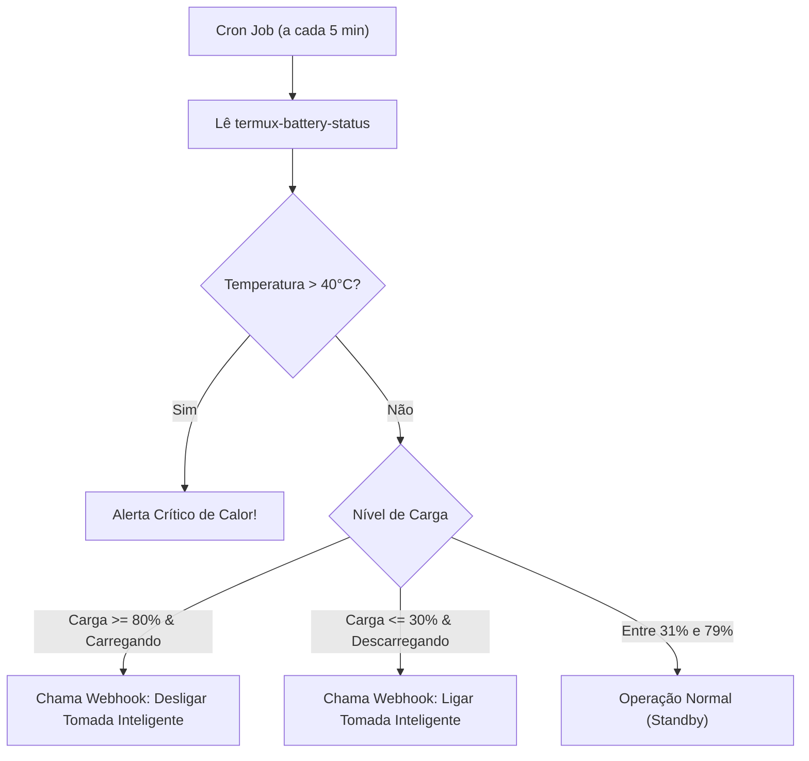

# Módulo 05: Automação de Boot, Monitoramento e Manutenção

Este módulo final detalha como tornar o Xiaomi Redmi Note 9S totalmente resiliente a reinicializações com o `Termux:Boot`, monitorar recursos e temperatura, e proteger ativamente a vida útil da bateria com o script de controle inteligente.

---

## 1. Inicialização Automática no Boot (`Termux:Boot`)

Quando o celular é reiniciado (ou após uma eventual queda de energia onde a bateria se esgotou e o aparelho religou ao receber carga), o aplicativo **Termux:Boot** executa todos os scripts presentes no diretório `~/.termux/boot/`.

### Configuração Passo a Passo:
1. Certifique-se de que o aplicativo **Termux:Boot** está instalado e com a opção *"Início Automático"* ativada na MIUI (conforme o [Módulo 01](file:///Users/naokiteruya/Projects/homelab/docs/01-preparacao-miui-android.md)).
2. Abra o aplicativo Termux:Boot pelo menos uma vez no celular para registrar as permissões no Android.
3. Crie o diretório de scripts de boot no Termux:
   ```bash
   mkdir -p ~/.termux/boot
   ```
4. Crie o script `~/.termux/boot/start-homelab.sh`:
   ```bash
   cat << 'EOF' > ~/.termux/boot/start-homelab.sh
   #!/data/data/com.termux/files/usr/bin/sh

   # 1. Garantir que o processador não durma
   termux-wake-lock

   # 2. Iniciar o servidor SSH
   sshd

   # 3. Iniciar o daemon de cron (para tarefas agendadas)
   crond

   # 4. Restaurar serviços gerenciados pelo PM2 (APIs, Web)
   if command -v pm2 > /dev/null 2>&1; then
       pm2 resurrect
   fi

   # 5. Iniciar serviços do termux-services (PostgreSQL, Caddy, etc)
   if [ -d "$PREFIX/var/service" ]; then
       # O daemon runit inicia automaticamente com termux-services
       sv up postgresql > /dev/null 2>&1 || true
   fi

   EOF

   # Dar permissão de execução
   chmod +x ~/.termux/boot/start-homelab.sh
   ```

---

## 2. Monitoramento de Recursos e Temperatura

### A. Monitoramento Interativo do Sistema
Para inspecionar o uso dos 8 núcleos do Snapdragon 720G e da memória RAM:
```bash
pkg install -y htop btop
btop   # ou htop
```

### B. Leituras de Hardware via `Termux:API`
Com o pacote `termux-api` instalado, você pode inspecionar o estado elétrico e térmico em tempo real:

```bash
# Ler status detalhado da bateria
termux-battery-status
```
Retorno em formato JSON:
```json
{
  "health": "GOOD",
  "percentage": 78,
  "plugged": "PLUGGED_AC",
  "status": "CHARGING",
  "temperature": 29.4
}
```
*Dica: Mantenha a temperatura da bateria idealmente abaixo de 38°C para garantir longevidade aos componentes.*

---

## 3. Automação de Proteção da Bateria (`battery-guard.sh`)

Manter o celular 24/7 conectado à tomada em 100% sob tensão constante pode causar estufamento da célula de lítio. Como estamos sem root e não podemos cortar a carga no nível de kernel, a melhor solução é **ciclar a bateria entre 30% e 80%** usando uma tomada inteligente Wi-Fi ou recebendo notificações para plugar/desplugar.

O script `scripts/battery-guard.sh` realiza essa leitura a cada 5 minutos via `cron`:



### Configurando o Agendamento no Cron:
No Termux:
```bash
# Abrir editor do crontab
crontab -e
```
Adicione a linha para checar a bateria a cada 5 minutos e o watchdog de Wi-Fi a cada 10 minutos:
```cron
*/5 * * * * $HOME/homelab/scripts/battery-guard.sh >> $HOME/battery-guard.log 2>&1
*/10 * * * * $HOME/homelab/scripts/wifi-watchdog.sh >> $HOME/wifi-watchdog.log 2>&1
```

---

## 4. Estratégia de Backup e Restauração

Recomenda-se realizar backups periódicos dos seus dados e configurações do Termux:

### Criar Backup Completo:
```bash
# Garantir permissão de armazenamento
termux-setup-storage

# Criar arquivo tar compactado no cartão SD ou memória interna
tar -czvf ~/storage/shared/homelab-backup-$(date +%Y%m%d).tar.gz \
  -C /data/data/com.termux/files/home \
  --exclude='storage' \
  --exclude='.cache' \
  --exclude='alpine-vm/alpine-disk.qcow2' \
  .
```

### Restaurar Backup em um Novo Aparelho:
```bash
tar -xzvf ~/storage/shared/homelab-backup-YYYYMMDD.tar.gz -C /data/data/com.termux/files/home/
```
