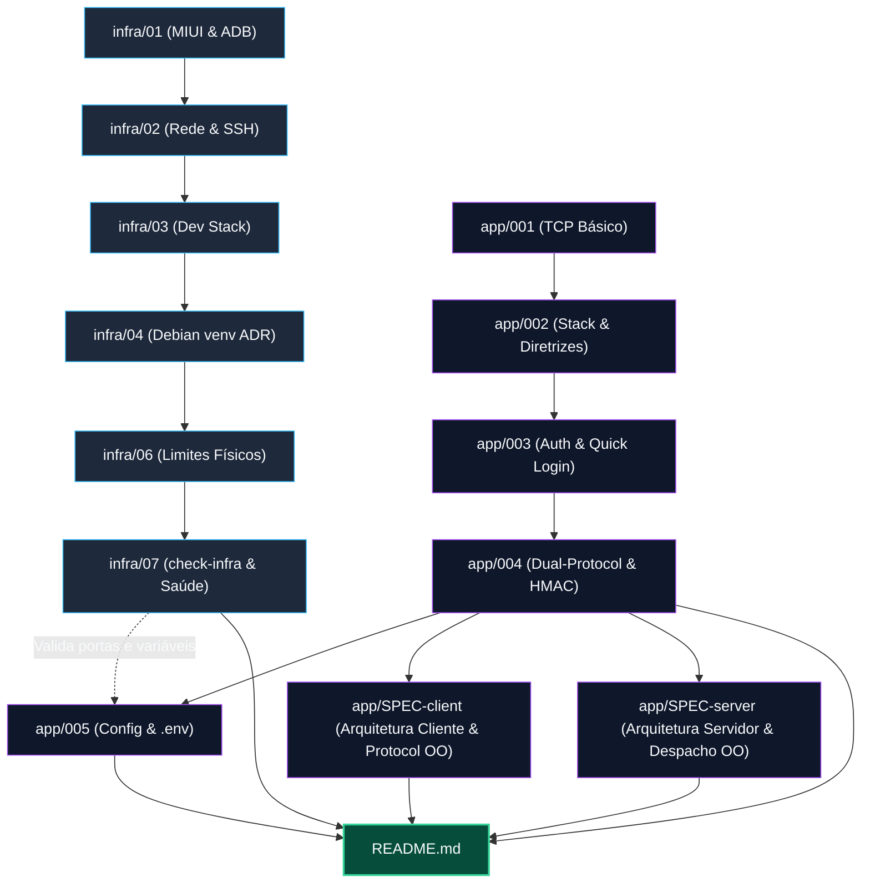

# Roteador Central de Documentação e Grafo de Arquitetura (Homelab)

> **Propósito:** Guia determinístico de navegação para o desenvolvedor e agentes de IA. Elimina a necessidade de "leituras no escuro" e mapeia a relação direta entre especificações, código-fonte e testes.

---

## 1. Roteador Temático Direto (Router de Domínio)

Consulte a tabela abaixo para ir diretamente ao documento de especificação, aos arquivos de implementação e aos testes correspondentes de cada assunto:

| Domínio / Assunto | Documento Canônico de Especificação | Implementação Principal | Suíte de Testes Automatizados |
| :--- | :--- | :--- | :--- |
| **Conexão TCP Básica e Logs** | [`docs/app/001-connection-tcp.md`](app/001-connection-tcp.md) | [`app/server/`](../app/server/), [`app/client/`](../app/client/) | [`tests/test_auth_and_session.py`](../tests/test_auth_and_session.py) |
| **Definição de Stacks & Arquitetura** | [`docs/app/002-stack-definicao-e-arquitetura.md`](app/002-stack-definicao-e-arquitetura.md) | Todo o diretório [`app/`](../app/) | Todas as suítes |
| **Autenticação, Clientes & Sessão NoSQL** | [`docs/app/003-client-auth-and-storage.md`](app/003-client-auth-and-storage.md) | [`app/database.py`](../app/database.py), [`app/client_session.py`](../app/client_session.py) | [`tests/test_auth_and_session.py`](../tests/test_auth_and_session.py) |
| **Framing Binário (40B) & HMAC Dinâmico** | [`docs/app/004-protocolos-controle-e-dados.md`](app/004-protocolos-controle-e-dados.md) | [`app/protocol.py`](../app/protocol.py) | [`tests/test_dual_protocol_and_chunks.py`](../tests/test_dual_protocol_and_chunks.py) |
| **Upload em Chunks (64KB) & Canal de Dados** | [`docs/app/004-protocolos-controle-e-dados.md`](app/004-protocolos-controle-e-dados.md) | [`app/server/`](../app/server/), [`app/client/`](../app/client/) | [`tests/test_dual_protocol_and_chunks.py`](../tests/test_dual_protocol_and_chunks.py) |
| **Arquitetura Modular do Cliente & Protocolo OO** | [`docs/app/SPEC-client-architecture.md`](app/SPEC-client-architecture.md) | [`app/client/`](../app/client/), [`app/protocol.py`](../app/protocol.py) | [`tests/test_auth_and_session.py`](../tests/test_auth_and_session.py), [`tests/test_adversarial_protocol_stress.py`](../tests/test_adversarial_protocol_stress.py) |
| **Arquitetura Modular do Servidor & Despacho OO** | [`docs/app/SPEC-server-architecture.md`](app/SPEC-server-architecture.md) | [`app/server/`](../app/server/), [`app/protocol.py`](../app/protocol.py) | [`tests/test_dual_protocol_and_chunks.py`](../tests/test_dual_protocol_and_chunks.py), [`tests/test_adversarial_protocol_stress.py`](../tests/test_adversarial_protocol_stress.py) |
| **Configurações, `.env` e Fail-Fast** | [`docs/app/005-gerenciamento-de-configuracoes-e-env.md`](app/005-gerenciamento-de-configuracoes-e-env.md) | [`app/config.py`](../app/config.py), [`envs/`](../envs/) | [`tests/test_config.py`](../tests/test_config.py) |
| **Preparação Android & MIUI (Bloatware, ADB)**| [`docs/infra/01-preparacao-miui-android.md`](infra/01-preparacao-miui-android.md) | Configurações do SO no aparelho | — |
| **Rede, SSH (8022/2022) e Tailscale** | [`docs/infra/02-rede-ssh-e-acesso-remoto.md`](infra/02-rede-ssh-e-acesso-remoto.md) | `~/.ssh/config` | — |
| **Stack Nativa Termux, Postgres & Caddy** | [`docs/infra/03-servicos-web-dev-e-bancos.md`](infra/03-servicos-web-dev-e-bancos.md) | [`scripts/02-setup-dev-stack.sh`](../scripts/02-setup-dev-stack.sh) | — |
| **Debian 11 (UserLAnd) + venv vs Docker (ADR)**| [`docs/infra/04-containers-docker-sem-root.md`](infra/04-containers-docker-sem-root.md) | [`scripts/03-setup-containers.sh`](../scripts/03-setup-containers.sh) | — |
| **Boot Automático, Cron & Battery Guard** | [`docs/infra/05-automacao-boot-e-manutencao.md`](infra/05-automacao-boot-e-manutencao.md) | [`scripts/battery-guard.sh`](../scripts/battery-guard.sh) | — |
| **Limites Físicos do Host (Redmi Note 9S)**| [`docs/infra/06-capacidade-e-limites-fisicos-do-host.md`](infra/06-capacidade-e-limites-fisicos-do-host.md) | Arquitetura Dual-Protocol | — |
| **Diagnóstico de Infra & Script Fail-Fast** | [`docs/infra/07-verificacao-e-saude-da-infraestrutura.md`](infra/07-verificacao-e-saude-da-infraestrutura.md) | [`scripts/check-infra.sh`](../scripts/check-infra.sh) | [`tests/test_check_infra.py`](../tests/test_check_infra.py) |
| **Padrões de Código, TDD e Flake8** | [`.gemini/rules/code-standards-and-workflow.md`](../.gemini/rules/code-standards-and-workflow.md) | [`.flake8`](../.flake8), [`scripts/run-lint.sh`](../scripts/run-lint.sh) | [`tests/test_code_standards.py`](../tests/test_code_standards.py) |
| **Inventário de Débitos Técnicos & OO** | [`docs/debts.md`](debts.md) | Roadmap de refatoração | Todas as suítes |

---

## 2. Grafo de Relações de Documentos (Origem $\rightarrow$ Destino)

Este grafo orienta a regra de [Ciclo de Propagação e Rastreamento de Documentação](../.gemini/rules/doc-propagation-lifecycle.md). Se um documento de origem for alterado, siga as setas para auditar os documentos que dele dependem:

---

## 3. Índice Estruturado Completo

### A. Documentação de Infraestrutura (`docs/infra/`)
1. [**01. Preparação da MIUI e Android**](infra/01-preparacao-miui-android.md): Limpeza de bloatware, suspensão na MIUI, Phantom Process Killer (Android 12+) e instalação do ecossistema Termux (F-Droid).
2. [**02. Rede, SSH e Acesso Remoto**](infra/02-rede-ssh-e-acesso-remoto.md): IP fixo, OpenSSH seguro (porta 8022 e 2022), chaves Ed25519 e túnel Tailscale sem abertura de portas no roteador.
3. [**03. Serviços Web, Dev e Bancos de Dados**](infra/03-servicos-web-dev-e-bancos.md): Stack compiladores ARM64, Python nativo, Node.js, PostgreSQL nativo, SQLite, Caddy Server e PM2.
4. [**04. Containers e Docker Sem Root**](infra/04-containers-docker-sem-root.md): Limitações do kernel Android para Docker, opções históricas (udocker/QEMU) e formalização da **Decisão Arquitetural (ADR)** de uso do **Debian 11 (UserLAnd) + Python `venv`**.
5. [**05. Automação de Boot, Monitoramento e Manutenção**](infra/05-automacao-boot-e-manutencao.md): Auto-inicialização via Termux:Boot, monitoramento de CPU/RAM e proteção de bateria (ciclo 30%-80% com `battery-guard.sh`).
6. [**06. Spike de Capacidade, Concorrência e Limites Físicos do Host**](infra/06-capacidade-e-limites-fisicos-do-host.md): Análise dos limites térmicos e de memória do Snapdragon 720G, desmistificação do 4-tuple TCP e justificativa do modelo dual-channel.
7. [**07. Verificação e Saúde da Infraestrutura**](infra/07-verificacao-e-saude-da-infraestrutura.md): Princípio Fail-Fast de declaração direta em arquivos de ambiente (`envs/`), guia de uso do `scripts/check-infra.sh` e matriz de troubleshooting do host.

### B. Documentação de Software e Aplicações (`docs/app/`)
1. [**001. Conexão TCP via Sockets e Persistência de Logs**](app/001-connection-tcp.md): Fundamentos de sockets TCP na porta 9000 e persistência de mensagens em `server_messages.log`.
2. [**002. Definição das Stacks de Infraestrutura e Software**](app/002-stack-definicao-e-arquitetura.md): Diretrizes arquiteturais oficiais em Python 3 nativo, matriz de portas e organização de diretórios.
3. [**003. Autenticação de Clientes, Classes OO e Quick Login**](app/003-client-auth-and-storage.md): Persistência no SQLite (`homelab.db`), classes OO `Client`, `Session` e `Message`, credenciais com PBKDF2 e Quick Login NoSQL.
4. [**004. Arquitetura Dual-Protocol (Controle Persistente e Chunks de Mídia)**](app/004-protocolos-controle-e-dados.md): Framing binário de 40B na porta 9000, streaming de chunks de 64KB na porta 9001 e assinatura HMAC-SHA256 com chave dinâmica.
5. [**005. Gerenciamento de Configurações, Variáveis de Ambiente e Arquivos .env**](app/005-gerenciamento-de-configuracoes-e-env.md): Módulo central `app/config.py`, separação `server.env` / `client.env`, precedência em camadas e fail-fast.
6. [**SPEC-client. Arquitetura Orientada a Objetos do Cliente e Protocolo Homelab**](app/SPEC-client-architecture.md): Especificação canônica da classe base abstrata `Package(ABC)`, hierarquia de pacotes `Message` e `MediaChunk`, decomposição do pacote modular `app/client/` (`session`, `conn_handler`, `commands`, `client`, `menus`) e governança de tipos e exceções.
7. [**SPEC-server. Arquitetura Modular do Servidor Homelab**](app/SPEC-server-architecture.md): Especificação canônica da decomposição modular em `app/server/` (`tickets`, `commands`, `conn_handler`, `server`), dispatcher de comandos desacoplado via padrão Command, gerenciamento thread-safe de tickets de upload e invariantes de autenticação PBKDF2, HMAC e presença.

### C. Governança de Engenharia, Qualidade e Débitos Técnicos
1. [**Inventário de Débitos Técnicos e Roadmap de Refatoração**](debts.md): Mapeamento das 5 áreas de dívida técnica (Arquitetura OO, remoção de exceptions genéricas, context managers, logging vs print e type hints).
2. [**Padrões de Código, TDD e Workflow de Execução**](../.gemini/rules/code-standards-and-workflow.md): Regra normativa para ciclo Red-Green-Refactor, configuração do Flake8, exceptions de domínio e mascaramento de segredos.
