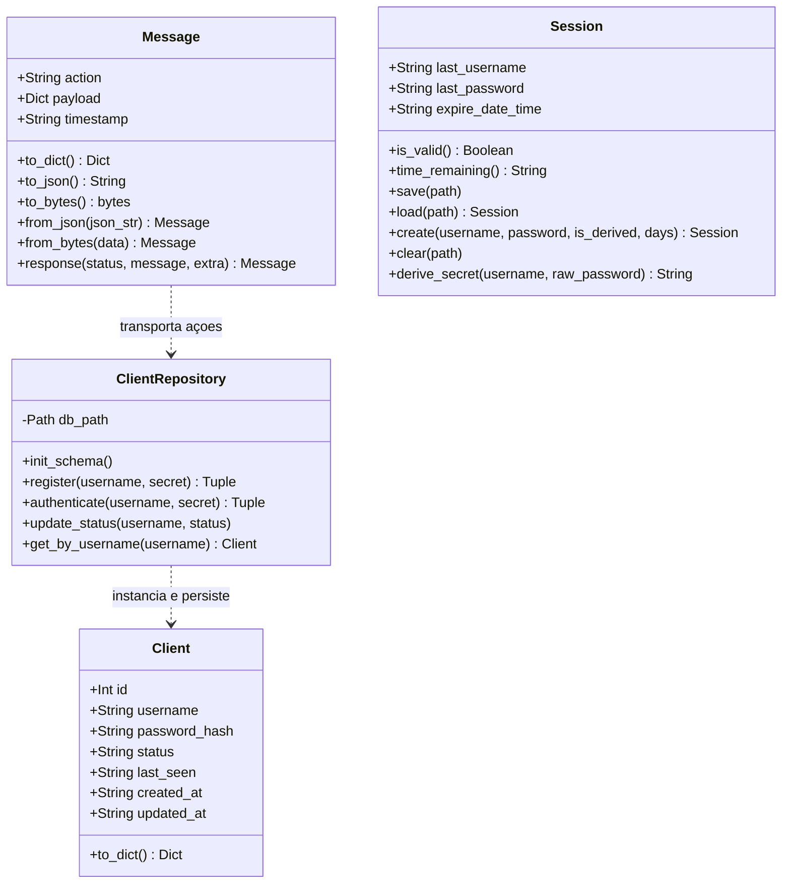

# Documento Técnico: Autenticação de Clientes, Classes OO e Armazenamento Local (Quick Login)

> **Status:** Implementado  
> **Branch:** `feature/client-auth-and-storage`  
> **Linguagem:** Python 3 (padrão com zero dependências externas)

---

## 1. Visão Geral

Este documento detalha o sistema de autenticação de clientes, persistência de dados em SQLite (com arquitetura desacoplada para migração ao PostgreSQL) e o mecanismo de **Quick Login** baseado em armazenamento local no cliente (formato de documento NoSQL em JSON).

### Principais Objetivos Entregues:
1. **Cadastro Explícito e Obrigatório:** O sistema exige que o cliente se registre formalmente antes de poder autenticar. Tentativas de login com usuários inexistentes não criam contas automaticamente.
2. **Modelo Orientado a Objetos (OO):** Separação de responsabilidades em 3 classes fundamentais:
   - `Message`: Envelope padronizado de protocolo de rede serializado em JSON.
   - `Client` / `ClientRepository`: Entidade de usuário e operações de persistência relacional.
   - `Session`: Gerenciador de estado local do cliente com expiração de 7 dias e proteção de credenciais.
3. **Segurança de Credenciais no Cliente e no Servidor:**
   - **No Cliente:** Senhas em texto puro nunca são salvas no disco. O cliente deriva uma credencial através de `SHA-256(username:raw_password)`. O arquivo `client_session.json` é gravado com permissões restritas `chmod 600`.
   - **No Servidor:** O servidor aplica **PBKDF2-HMAC-SHA256 com salt aleatório de 16 bytes e 100.000 iterações** sobre a credencial recebida.
4. **Quick Login com Auto-Login:**
   - Após cadastro ou login com sucesso, uma sessão de 7 dias é gerada no cliente.
   - Ao reabrir o cliente, o usuário é questionado se deseja aceitar o Quick Login para o último usuário. Se aceitar, a conexão é liberada sem redigitação de credenciais.

---

## 2. Esquema da Tabela `clients` (Servidor SQLite / PostgreSQL)

A tabela `clients` é gerenciada pela classe `ClientRepository` no arquivo `app/data/homelab.db`:

```sql
CREATE TABLE IF NOT EXISTS clients (
    id INTEGER PRIMARY KEY AUTOINCREMENT,
    username TEXT UNIQUE NOT NULL,
    password TEXT NOT NULL,
    status TEXT NOT NULL DEFAULT 'offline',
    last_seen TEXT,
    created_at TEXT NOT NULL,
    updated_at TEXT NOT NULL
);
```

| Coluna | Tipo | Descrição |
| :--- | :--- | :--- |
| `id` | `INTEGER PRIMARY KEY` | Identificador único autoincremental |
| `username` | `TEXT UNIQUE` | Nome de usuário único (mínimo de 3 caracteres) |
| `password` | `TEXT` | Hash seguro no formato `salt$iteracoes$hash` |
| `status` | `TEXT` | Estado de presença: `'online'` ou `'offline'` |
| `last_seen` | `TEXT (ISO 8601)` | Timestamp do último contato/desconexão do cliente |
| `created_at` | `TEXT (ISO 8601)` | Data e hora do cadastro |
| `updated_at` | `TEXT (ISO 8601)` | Data e hora da última modificação |

> [!NOTE]
> A sintaxe SQL utilizada é 100% compatível com a migração futura para **PostgreSQL** (apenas alterando o tipo `INTEGER PRIMARY KEY AUTOINCREMENT` para `SERIAL PRIMARY KEY` ou `GENERATED ALWAYS AS IDENTITY`).

---

## 3. Armazenamento NoSQL no Cliente (`client_session.json`)

No cliente, os dados de sessão rápida são salvos em `app/data/client_session.json`:

```json
{
  "last_username": "naoki",
  "last_password": "e3b0c44298fc1c149afbf4c8996fb92427ae41e4649b934ca495991b7852b855",
  "expire_date_time": "2026-11-07T09:25:00.000000"
}
```

* **`last_username`**: Último nome de usuário autenticado.
* **`last_password`**: Hash SHA-256 derivado da senha.
* **`expire_date_time`**: Timestamp de expiração (7 dias após o login ou renovação).

---

## 4. Diagrama de Classes e Responsabilidades



---

## 5. Fluxo de Navegação da Interface Terminal

```text
==================================================
        HOMELAB TCP CLIENT - ACESSO
==================================================
  1. Login
  2. Register (Criar nova conta)
  3. Sair
==================================================
```

### Cenário 1: Primeiro Acesso (Cadastro Obrigatório)
1. Usuário seleciona `2. Register`.
2. Informa `Username` e `Senha` (com confirmação oculta no terminal).
3. Servidor cadastra o usuário no SQLite e retorna sucesso.
4. O cliente dispara o **Auto-login**, salvando a sessão no arquivo `client_session.json` com validade de 7 dias.
5. Inicia o prompt de transmissão de mensagens.

### Cenário 2: Próximos Acessos (Quick Login)
1. Usuário executa `python3 app/client.py`.
2. O cliente detecta o arquivo `client_session.json` com data válida:
   ```text
   [?] Quick login disponível para 'naoki' (6d 23h restantes). Deseja aceitar? [S/n]:
   ```
3. Pressionando **Enter** ou digitando **S**:
   - A credencial salva é enviada ao servidor.
   - O servidor autentica, marca `status = 'online'` e confirma.
   - A sessão é renovada por mais 7 dias.
   - O usuário entra direto sem precisar digitar credenciais.

---

## 6. Como Executar e Validar

### Iniciar o Servidor:
```bash
python3 app/server.py
```

### Iniciar o Cliente:
```bash
python3 app/client.py
```

### Executar os Testes Automatizados:
```bash
python3 -m unittest discover -s tests -v
```
