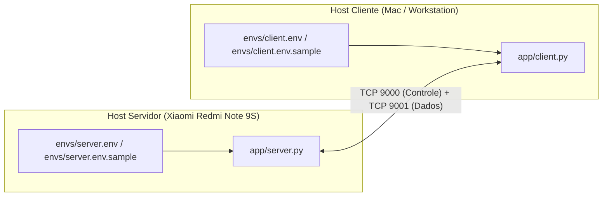

# Documento Técnico: Gerenciamento de Configurações, Variáveis de Ambiente e Arquivos .env

> **Status:** Implementado  
> **Branch:** `feature/env-configuration`  
> **Módulo:** `app/config.py`  
> **Dependência:** `python-dotenv>=1.0.0` (com fallback nativo)  

---

## 1. Visão Geral e Motivação

Nas fases iniciais do Homelab, parâmetros de rede e infraestrutura — tais como endereços IP de bind (`0.0.0.0`) e destino (`192.168.0.246`), portas de escuta (`9000` e `9001`), timeouts, caminhos de banco SQLite e chave secreta de handshake HMAC — estavam definidos diretamente como constantes fixas nos arquivos de código-fonte (`server.py`, `client.py` e `protocol.py`).

Isso exigia edição manual de código a cada mudança de ambiente (ex: alternar entre rede Wi-Fi local do celular e loopback local para testes), aumentando o risco de commits acidentais de dados de rede ou credenciais.

Para resolver isso, o sistema implementa um **Gerenciador Centralizado de Configurações** em [`app/config.py`](file:///Users/naokiteruya/Projects/homelab/app/config.py) que:
1. Separa formalmente as configurações do host do **Servidor** (`envs/server.env`) e da máquina do **Cliente** (`envs/client.env`).
2. Mantém suporte a um arquivo unificado (`envs/.env`) para desenvolvimento e homologação local.
3. Carrega valores via `python-dotenv` com fallback automático para variáveis de ambiente do sistema operacional (`os.environ`).
4. Oferece valores padrão (*safe defaults*) funcionais para todas as constantes, com arquitetura preparada para validação estrita (*Fail Fast*).

---

## 2. Separação de Ambientes: Servidor vs. Cliente

Como o servidor Homelab roda no smartphone **Xiaomi Redmi Note 9S** (via Termux) e os clientes rodam em estações de trabalho distintas (Mac, Linux ou outros PCs da LAN), os parâmetros de configuração foram segregados dentro da pasta `envs/`:



### Arquivos Modelos (.sample) rastreados no Git:
* [`envs/server.env.sample`](file:///Users/naokiteruya/Projects/homelab/envs/server.env.sample): Template com os parâmetros do servidor.
* [`envs/client.env.sample`](file:///Users/naokiteruya/Projects/homelab/envs/client.env.sample): Template com os parâmetros do cliente.
* [`envs/.env.sample`](file:///Users/naokiteruya/Projects/homelab/envs/.env.sample): Template unificado contendo ambos os conjuntos para desenvolvedores.

> [!IMPORTANT]
> Os arquivos locais `envs/server.env`, `envs/client.env`, `envs/.env` e qualquer arquivo terminado em `*.env` são rigidamente ignorados no [`.gitignore`](file:///Users/naokiteruya/Projects/homelab/.gitignore), impedindo que dados do host local sejam comitados acidentalmente.

---

## 3. Tabela Completa de Variáveis de Ambiente

| Variável | Escopo | Tipo | Padrão (Fallback) | Descrição |
| :--- | :--- | :--- | :--- | :--- |
| `HOMELAB_SERVER_HOST` | Servidor | `str` | `0.0.0.0` | Endereço IP onde o servidor aguarda conexões |
| `HOMELAB_CLIENT_TARGET_HOST` | Cliente | `str` | `192.168.0.246` | IP do servidor Homelab remoto |
| `HOMELAB_CONTROL_PORT` | Ambos | `int` | `9000` | Porta TCP do Canal de Controle Persistente |
| `HOMELAB_DATA_PORT` | Ambos | `int` | `9001` | Porta TCP do Canal de Dados e Mídia |
| `HOMELAB_HANDSHAKE_KEY` | Ambos | `str/bytes` | `homelab-initial-handshake-key-32` | Chave prévia para enquadramento inicial HMAC |
| `HOMELAB_CHUNK_SIZE` | Ambos | `int` | `65536` (64 KB) | Tamanho de cada bloco fatiado para upload |
| `HOMELAB_BUFFER_SIZE` | Ambos | `int` | `4096` (4 KB) | Tamanho padrão do buffer de recepção/leitura |
| `HOMELAB_DB_PATH` | Servidor | `Path` | `app/data/homelab.db` | Caminho do arquivo de banco SQLite |
| `HOMELAB_LOG_PATH` | Servidor | `Path` | `app/logs/server_messages.log` | Caminho do log de mensagens recebidas |
| `HOMELAB_UPLOADS_DIR` | Servidor | `Path` | `app/data/uploads` | Diretório de destino de uploads em chunks |
| `HOMELAB_CLIENT_TIMEOUT` | Cliente | `float` | `10.0` | Timeout de conexões de socket em segundos |
| `HOMELAB_SESSION_PATH` | Cliente | `Path` | `app/data/client_session.json` | Arquivo NoSQL de Quick Login local |

---

## 4. Ordem de Precedência em Camadas

O sistema aplica as configurações respeitando a seguinte hierarquia estrita:

1. **Parâmetros de Linha de Comando (CLI):** Flags passadas diretamente (ex: `--host 127.0.0.1`, `--port 9500`) têm a prioridade máxima.
2. **Arquivo Explícito (`--env-file <caminho>`):** Se o usuário apontar um arquivo específico via argumento, suas variáveis são carregadas prioritariamente.
3. **Arquivo de Ambiente Dedicado:**
   - Servidor: busca `envs/server.env` (ou `server.env` na raiz).
   - Cliente: busca `envs/client.env` (ou `client.env` na raiz).
4. **Arquivo de Ambiente Unificado (`.env`):** Caso o arquivo dedicado não exista, busca `envs/.env` (ou `.env` na raiz).
5. **Variáveis de Ambiente do SO (`os.environ`):** Se já exportadas no terminal (`export HOMELAB_CONTROL_PORT=9000`), sobrepõem os arquivos a menos que haja `--env-file` com override.
6. **Valores Padrão em Código (*Safe Defaults*):** Se nenhuma das opções acima for encontrada, as constantes seguras padrão são mantidas.

---

## 5. Preparação para *Fail Fast*

A classe de configuração inclui o hook `validate(fail_fast=True)` e os leitores com flag `required=True`:

```python
from app.config import ConfigValidationError, load_server_config

# Modo padrão: usa fallbacks seguros
config = load_server_config()

# Modo Fail Fast: valida limites e impede inicialização se houver parâmetros críticos ausentes ou inválidos
try:
    config = load_server_config(fail_fast=True)
except ConfigValidationError as e:
    print(f"[ERRO CRÍTICO DE CONFIGURAÇÃO] {e}")
```

---

## 6. Exemplos de Uso

### 6.1. Inicialização Padrão (utiliza automaticamente `envs/server.env` e `envs/client.env`)
```bash
# Servidor
python3 app/server.py

# Cliente
python3 app/client.py
```

### 6.2. Usando um arquivo de ambiente customizado
```bash
# Servidor em ambiente customizado
python3 app/server.py --env-file envs/server.homolog.env

# Cliente apontando para arquivo customizado
python3 app/client.py --env-file envs/client.local.env
```

### 6.3. Sobrescrita pontual via CLI
```bash
# Servidor escutando em porta diferente sem alterar o arquivo .env
python3 app/server.py --port 9500 --data-port 9501
```
