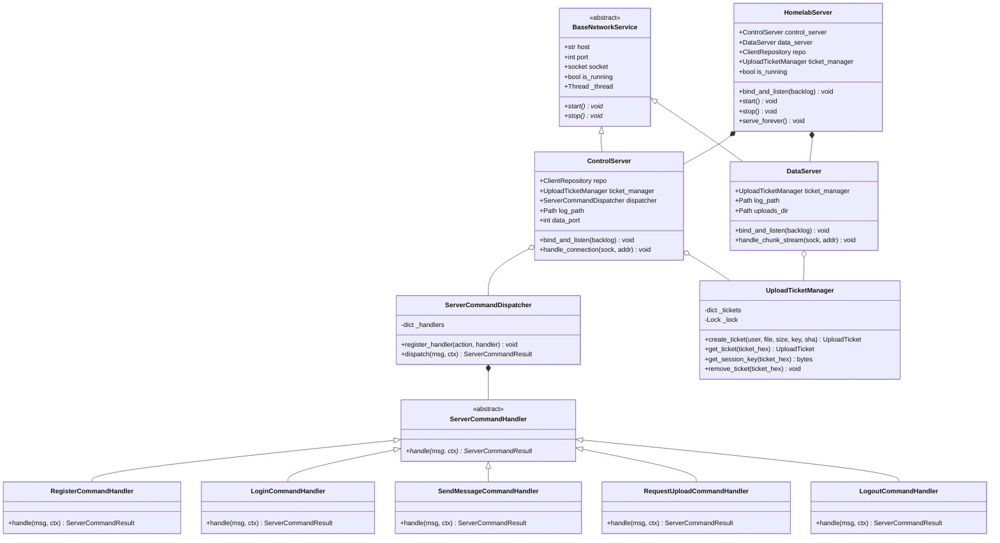

# Especificação Técnica Canônica: Arquitetura Modular do Servidor Homelab (`app/server/`)

> **Documento:** `docs/app/SPEC-server-architecture.md`  
> **Status:** Normativo / Aprovado  
> **Linguagem:** Python 3 (3.11+)  
> **Módulo:** `app/server/`  
> **Referência:** `ORIGINAL_REQUEST.md` (R2, R5) | `docs/INDEX.md` | `docs/debts.md` (DEBT-01)

---

## 1. Visão Geral da Arquitetura

O servidor Homelab opera uma arquitetura **Dual-Channel TCP**:
1. **Canal de Controle (Porta `9000`):** Conexão persistente (*Keep-Alive*) por cliente (Thread-per-Client) com enquadramento binário de 40 bytes (`CONTROL_HEADER_SIZE`), assinatura HMAC-SHA256 dinâmica e protocolo de mensagens JSON (`Message`).
2. **Canal de Dados/Mídia (Porta `9001`):** Conexões sob demanda para transporte de arquivos binários fatiados em chunks indexados de até 64 KB (`CHUNK_SIZE = 65536` bytes), com cabeçalho binário fixo de 62 bytes (`CHUNK_HEADER_SIZE`) e gravação posicional direta no disco (*streaming* sem buffer completo em RAM).

A modularização decompõe o arquivo monolítico `app/server.py` no pacote estruturado `app/server/`, introduzindo o padrão Command para eliminar a complexidade ciclomática do roteador de controle e desacoplando a camada de tickets, rede e ciclo de vida do servidor.



---

## 2. Estrutura do Pacote `app/server/`

```text
app/server/
├── __init__.py          # Exportações públicas e retrocompatibilidade com testes legados
├── __main__.py          # Ponto de entrada CLI (argparse, flags --env-file, --port, etc.)
├── tickets.py           # UploadTicket, UploadTicketManager, compute_file_sha256, log_message
├── commands.py          # ServerCommandContext, ServerCommandResult, Handlers e Dispatcher
├── conn_handler.py      # BaseNetworkService, ControlServer, DataServer e rotinas de conexão
└── server.py            # HomelabServer, Server, DualChannelServer, start_server
```

---

## 3. Contratos de Módulos e Assinaturas de Classes

### 3.1. `app/server/tickets.py`

Centraliza a governança de upload de arquivos e integridade de disco.

#### `UploadTicket` (Dataclass)
```python
@dataclass
class UploadTicket:
    ticket_hex: str
    username: str
    filename: str
    file_size: int
    total_chunks: int
    session_key: bytes
    dest_path: Path
    expected_sha256: Optional[str] = None
    received_chunks: Set[int] = field(default_factory=set)
```

#### `UploadTicketManager`
Gerenciador thread-safe protegido por `threading.Lock`.

- `__init__(uploads_dir: Path = DEFAULT_UPLOADS_DIR) -> None`
- `create_ticket(username: str, filename: str, file_size: int, session_key: bytes, expected_sha256: Optional[str] = None) -> UploadTicket`:
  - Sanitiza o nome do arquivo (`Path(filename).name or "upload.bin"`).
  - Emite token criptográfico de 16 bytes via `generate_upload_ticket()`.
  - Isola o destino em `uploads_dir / username / f"{timestamp}_{ticket_hex[:8]}_{safe_name}"`.
  - Calcula `total_chunks = max(1, math.ceil(file_size / CHUNK_SIZE)) if file_size > 0 else 1`.
  - Pré-aloca o arquivo em disco via `f.truncate(file_size)` se `file_size > 0`.
  - Registra a autorização thread-safe em `_tickets`.
- `get_ticket(ticket_hex: str) -> Optional[UploadTicket]`: Consulta thread-safe.
- `get_session_key(ticket_hex: str) -> Optional[bytes]`: Resolve a chave de sessão HMAC associada ao ticket (passada como `key_resolver` para `MediaChunk.recv_from_socket`).
- `remove_ticket(ticket_hex: str) -> None`: Revoga e remove o ticket de forma thread-safe.

#### Funções Utilitárias:
- `compute_file_sha256(file_path: Path) -> str`: Lê o arquivo em streaming de blocos de 64 KB (`CHUNK_SIZE`) e calcula o hash hexadecimal sem estourar o limite de memória.
- `log_message(log_file_path: Path, client_address: Tuple[str, int], message: str, username: Optional[str] = None) -> None`: Formata a entrada com timestamp no formato `[YYYY-MM-DD HH:MM:SS] [sender@IP:PORT] MESSAGE`.

---

### 3.2. `app/server/commands.py`

Implementa o padrão Command para rotear e processar ações do Canal de Controle, garantindo complexidade ciclomática <= 4 por handler.

#### Estruturas de Dados:
```python
@dataclass
class ServerCommandContext:
    client_address: Tuple[str, int]
    repo: ClientRepository
    log_path: Path
    authenticated_user: Optional[str] = None
    session_key: bytes = DEFAULT_HANDSHAKE_KEY
    ticket_manager: Optional[UploadTicketManager] = None
    data_port: int = DEFAULT_DATA_PORT

@dataclass
class ServerCommandResult:
    response: Message
    authenticated_user: Optional[str] = None
    session_key: bytes = DEFAULT_HANDSHAKE_KEY
```

#### Interface Base:
```python
class ServerCommandHandler(ABC):
    @abstractmethod
    def handle(self, msg: Message, ctx: ServerCommandContext) -> ServerCommandResult:
        """Processa a mensagem e retorna o resultado com nova resposta e chave de sessão."""
        pass
```

#### Concrete Handlers:
1. `RegisterCommandHandler`:
   - Ação: `Message.ACTION_REGISTER` (`"register"`).
   - Extrai `username` e `password`.
   - Executa `ctx.repo.register(username, password)`.
   - Se OK: atualiza presença para `"online"`, gera nova chave dinâmica via `generate_session_key()`, retorna `STATUS_OK` com payload contendo `session_key: hex`, atualiza `authenticated_user` e `session_key`.
   - Se falha: retorna `STATUS_ERROR` com mensagem descritiva mantendo o estado de contexto inalterado.
2. `LoginCommandHandler`:
   - Ação: `Message.ACTION_LOGIN` (`"login"`).
   - Extrai `username` e `password`.
   - Executa `ctx.repo.authenticate(username, password)`.
   - Se OK: atualiza presença para `"online"`, gera nova `session_key`, retorna `STATUS_OK`.
   - Se falha: retorna `STATUS_ERROR` mantendo contexto inalterado.
3. `SendMessageCommandHandler`:
   - Ação: `Message.ACTION_SEND` (`"send"`).
   - Validação de sessão: se `ctx.authenticated_user and username == ctx.authenticated_user`, confia na autenticidade validada pelo HMAC e ignora re-hash PBKDF2; caso contrário, revalida credenciais no banco SQLite.
   - Atualiza presença para `"online"`.
   - Registra no log de auditoria via `log_message()`.
   - Retorna `STATUS_OK` com timestamp.
4. `RequestUploadCommandHandler`:
   - Ação: `Message.ACTION_REQUEST_UPLOAD` (`"request_upload"`).
   - Valida autenticação (sessão HMAC ou credenciais).
   - Valida `ticket_manager is not None` e `file_size >= 0`.
   - Emite ticket através de `ctx.ticket_manager.create_ticket(...)`.
   - Retorna `STATUS_OK` com `ticket: hex`, `chunk_size: 65536`, `total_chunks`, `data_port`.
5. `LogoutCommandHandler`:
   - Ação: `Message.ACTION_LOGOUT` (`"logout"`).
   - Se `ctx.authenticated_user`, chama `ctx.repo.update_status(ctx.authenticated_user, "offline")`.
   - Retorna `STATUS_OK`, resetando `authenticated_user = None` e `session_key = DEFAULT_HANDSHAKE_KEY`.

#### Despachante:
```python
class ServerCommandDispatcher:
    def __init__(self) -> None:
        self._handlers: Dict[str, ServerCommandHandler] = {}

    def register_handler(self, action: str, handler: ServerCommandHandler) -> None:
        self._handlers[action] = handler

    def dispatch(self, msg: Message, ctx: ServerCommandContext) -> ServerCommandResult:
        handler = self._handlers.get(msg.action)
        if not handler:
            resp = Message.response(Message.STATUS_ERROR, f"Ação desconhecida: '{msg.action}'")
            return ServerCommandResult(resp, ctx.authenticated_user, ctx.session_key)
        return handler.handle(msg, ctx)
```

#### Funções de Retrocompatibilidade:
- `process_control_message(msg, client_address, repo, log_path, authenticated_user=None, session_key=DEFAULT_HANDSHAKE_KEY, ticket_manager=None, data_port=DEFAULT_DATA_PORT, dispatcher=None) -> Tuple[Message, Optional[str], bytes]`:
  Constrói `ServerCommandContext`, despacha via `ServerCommandDispatcher` e desempacota a tupla `(result.response, result.authenticated_user, result.session_key)`.
- `handle_client_payload(raw_data, client_address, repo, log_path, ticket_manager=None, data_port=DEFAULT_DATA_PORT) -> Tuple[bytes, Optional[str]]`:
  Processa requisições pontuais un-framed (JSON legado ou texto puro), garantindo compatibilidade com clientes antigos e testes de integração.

---

### 3.3. `app/server/conn_handler.py`

Centraliza a infraestrutura de rede, listeners TCP e workers de conexão.

#### `BaseNetworkService(ABC)`
```python
class BaseNetworkService(ABC):
    def __init__(self, host: str, port: int) -> None:
        self.host: str = host
        self.port: int = port
        self.socket: Optional[socket.socket] = None
        self.is_running: bool = False
        self._thread: Optional[threading.Thread] = None

    @abstractmethod
    def start(self) -> None:
        pass

    @abstractmethod
    def stop(self) -> None:
        pass
```

#### `ControlServer(BaseNetworkService)`
- Gerencia o listener TCP na porta 9000 (`SO_REUSEADDR`, timeout 1.0s, backlog 16).
- `start()` inicia thread daemon de `_accept_loop()`.
- Aceita conexões e despacha worker thread `_handle_client_thread` protegida por `contextlib.closing(client_sock)`.
- Delega o protocolo para `handle_control_client_connection`.

#### `DataServer(BaseNetworkService)`
- Gerencia o listener TCP na porta 9001 (`SO_REUSEADDR`, timeout 1.0s, backlog 16).
- `start()` inicia thread daemon de `_accept_loop()`.
- Aceita conexões e despacha worker thread `_handle_client_thread` protegida por `contextlib.closing(client_sock)`.
- Delega o streaming para `handle_data_client_connection`.

#### Funções de Conexão:
- `handle_control_client_connection(...)`:
  - Lê os primeiros 2 bytes. Se `CONTROL_MAGIC` (`b"HC"`), entra em loop `Message.recv_framed()`.
  - Processa cada frame com `dispatcher.dispatch()`, envia resposta com a chave vigente e atualiza para `next_hmac_key`.
  - Trata exceções canônicas (`ProtocolError`, `HMACVerificationError`, `AuthenticationError`, `StorageError`, `TimeoutError`).
  - No bloco `finally:`, se `active_username` estiver definido, executa obrigatoriamente:
    ```python
    if active_username:
        try:
            repo.update_status(active_username, "offline")
        except (StorageError, sqlite3.DatabaseError):
            pass
    ```
- `handle_data_client_connection(...)`:
  - Lê chunks sequenciais com `MediaChunk.recv_from_socket(client_socket, key_resolver=ticket_manager.get_session_key)`.
  - Grava cada chunk na posição calculada (`f.seek(chunk.chunk_index * CHUNK_SIZE)`).
  - Adiciona o índice do chunk em `ticket.received_chunks`.
  - Ao receber todos os chunks: calcula `compute_file_sha256(ticket.dest_path)`. Se divergir de `expected_sha256`, apaga o arquivo (`unlink`) e retorna `STATUS_ERROR`. Se conferir, envia `STATUS_OK`, registra log de conclusão e revoga o ticket.

---

### 3.4. `app/server/server.py`

Orquestrador do sistema.

#### `HomelabServer`
```python
class HomelabServer:
    def __init__(
        self,
        host: str = DEFAULT_HOST,
        control_port: int = DEFAULT_PORT,
        data_port: int = DEFAULT_DATA_PORT,
        log_path: Path = DEFAULT_LOG_PATH,
        db_path: Path = DEFAULT_DB_PATH,
        uploads_dir: Path = DEFAULT_UPLOADS_DIR,
        config: Optional[ServerConfig] = None,
    ) -> None:
        ...
```
- Instancia instâncias compartilhadas de `ClientRepository` e `UploadTicketManager`.
- Cria `ControlServer` e `DataServer`.
- Métodos:
  - `bind_and_listen(backlog: int = 16) -> None`: Prepara e amarra sockets em modo passivo.
  - `start() -> None`: Inicia daemons de controle e dados em segundo plano.
  - `start_in_background() -> None`: Alias de conveniência.
  - `stop() -> None`: Encerra ambos os listeners e threads de forma graciosa.
  - `serve_forever() -> None`: Inicia os serviços e bloqueia na thread principal até receber `KeyboardInterrupt` (SIGINT).
  - Context Manager: `__enter__() -> HomelabServer` e `__exit__(...) -> None`.
- Propriedades de conveniência:
  - `host -> str`
  - `control_port -> int` (getter/setter)
  - `data_port -> int` (getter/setter)
  - `control_socket -> Optional[socket.socket]`
  - `data_socket -> Optional[socket.socket]`
  - `running -> bool` (getter/setter)

#### Aliases Retrocompatíveis:
```python
DualChannelServer = HomelabServer
Server = HomelabServer
```

#### Função de Inicialização:
- `start_server(host, port, log_path, db_path, data_port=DEFAULT_DATA_PORT, uploads_dir=DEFAULT_UPLOADS_DIR) -> None`

---

### 3.5. `app/server/__init__.py`

Garante 100% de retrocompatibilidade para suítes de testes e importações existentes.

```python
from app.server.tickets import UploadTicket, UploadTicketManager, compute_file_sha256, log_message
from app.server.commands import (
    ServerCommandContext,
    ServerCommandResult,
    ServerCommandHandler,
    RegisterCommandHandler,
    LoginCommandHandler,
    SendMessageCommandHandler,
    RequestUploadCommandHandler,
    LogoutCommandHandler,
    ServerCommandDispatcher,
    process_control_message,
    handle_client_payload,
)
from app.server.conn_handler import (
    BaseNetworkService,
    ControlServer,
    DataServer,
    handle_control_client_connection,
    handle_data_client_connection,
)
from app.server.server import HomelabServer, DualChannelServer, Server, start_server
from app.server.__main__ import main

__all__ = [
    "UploadTicket",
    "UploadTicketManager",
    "compute_file_sha256",
    "log_message",
    "ServerCommandContext",
    "ServerCommandResult",
    "ServerCommandHandler",
    "RegisterCommandHandler",
    "LoginCommandHandler",
    "SendMessageCommandHandler",
    "RequestUploadCommandHandler",
    "LogoutCommandHandler",
    "ServerCommandDispatcher",
    "process_control_message",
    "handle_client_payload",
    "BaseNetworkService",
    "ControlServer",
    "DataServer",
    "handle_control_client_connection",
    "handle_data_client_connection",
    "HomelabServer",
    "DualChannelServer",
    "Server",
    "start_server",
    "main",
]
```

---

### 3.6. `app/server/__main__.py`

Permite a execução como módulo CLI (`python3 -m app.server` ou `python3 app/server`):
- Suporta pré-parsing da flag `--env-file` com `load_server_config()`.
- Suporta argumentos `--host`, `--port`, `--data-port`, `--log`, `--db`, `--uploads-dir`.
- Invoca `start_server(...)`.

---

## 4. Invariantes de Segurança e Proteções Críticas

1. **Autenticação PBKDF2 Segura**:
   - Algoritmo: PBKDF2-HMAC-SHA256, 100.000 rounds, salt criptográfico de 16 bytes (`secrets.token_hex(16)`).
   - Otimização de autenticação contínua: Após autenticação no canal de controle, mensagens subsequentes com `username == authenticated_user` utilizam a assinatura HMAC do frame persistente para comprovar identidade, eliminando overhead computacional repetido de PBKDF2 sem degradar segurança.
2. **Rotação Dinâmica de Chaves HMAC**:
   - Pacotes pré-login utilizam `DEFAULT_HANDSHAKE_KEY` (32 bytes).
   - Ao autenticar com sucesso, o servidor gera uma nova chave aleatória de 32 bytes (`os.urandom(32)`), enviada ao cliente no payload.
   - A conexão passa a exigir imediatamente essa nova chave em todos os quadros de controle e chunks de dados daquele usuário.
   - Ao executar `logout`, a chave de sessão do canal reverte para `DEFAULT_HANDSHAKE_KEY`.
   - Comparação constante via `hmac.compare_digest` para neutralizar ataques de temporização (*timing attacks*).
3. **Ciclo de Vida Determinístico de Presença**:
   - Usuário marcado como `"online"` no SQLite ao registrar, logar ou enviar mensagem autenticada.
   - Usuário marcado como `"offline"` no SQLite em caso de encerramento voluntário (`ACTION_LOGOUT`).
   - Usuário marcado obrigatoriamente como `"offline"` no bloco `finally:` de `handle_control_client_connection` em quedas de conexão, EOF prematuro, timeouts ou falhas de protocolo.
4. **Proteção de Memória e Streaming em Disco**:
   - Chunks têm limite rígido de 64 KB (`CHUNK_SIZE = 65536`).
   - O arquivo é pré-alocado em disco via `f.truncate(file_size)` e chunks são gravados diretamente na posição correta (`f.seek()`), evitando retenção de arquivos pesados na memória RAM do Snapdragon 720G.
   - Integridade conferida via SHA-256 após recepção completa. Caso o hash divirja de `expected_sha256`, o arquivo no disco é imediatamente excluído (`unlink()`).
5. **Mascaramento e Sanitização de Segredos**:
   - Aplicação mandatória de `mask_secret()` e `mask_password()` em logs e telas. Proibida exibição de chaves de sessão completas ou senhas em texto puro.

---

## 5. Rastreamento e Alinhamento de Infraestrutura

- **Detecção de Processos (`scripts/check-infra.sh`)**:
  A detecção de processo do servidor deve ser atualizada de:
  `pgrep -f "app/server.py"`
  Para contemplar invocação como pacote:
  `pgrep -f "app/server(\.py)?|app\.server"`
- **Grafo de Propagação**:
  Atualizações em `docs/INDEX.md`, `docs/debts.md`, `docs/app/002-stack-definicao-e-arquitetura.md` e `.gemini/rules/commands.md` devem apontar diretamente para este documento canônico.
