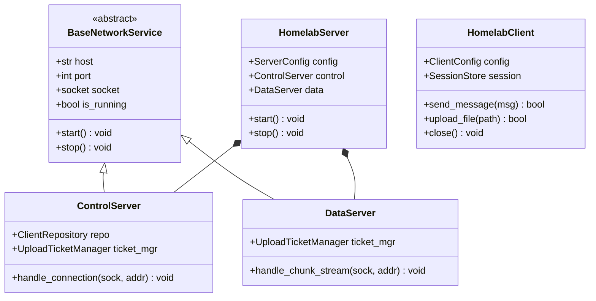

# Registro Canônico de Débitos Técnicos e Roadmap de Refatoração

> **Status:** Ativo  
> **Propósito:** Mapear, quantificar e orientar a resolução progressiva dos débitos técnicos acumulados na camada de código do Homelab, preservando o funcionamento atual e guiando as próximas fases de evolução.

---

## 1. Visão Geral dos Débitos Mapeados

A tabela abaixo sumariza as divergências técnicas identificadas no repositório, categorizadas por prioridade de mitigação e impacto arquitetural:

| ID | Área / Domínio | Gravidade | Descrição do Débito | Alvo da Refatoração |
| :--- | :--- | :--- | :--- | :--- |
| **DEBT-01** | **Arquitetura OO da Rede** | Média | Camada de sockets e threads procedural em `server.py` e `client.py` | Classes `HomelabServer`, `ControlServer`, `DataServer` e `HomelabClient` |
| **DEBT-02** | **Exceções Genéricas** | Alta | 22 ocorrências de `except Exception:` e capturas sem tipagem | Adoção estrita da hierarquia em `app/exceptions.py` |
| **DEBT-03** | **Gerenciamento de Recursos** | Alta | `ResourceWarning: unclosed database` e sockets sem `with` | Uso mandatório de Context Managers e fechamento garantido |
| **DEBT-04** | **Logging vs `print`** | Média | Uso de `print()` solto em código de servidor e ausência de mascarador | Padronização em `logging` nativo com `mask_secret()` |
| **DEBT-05** | **Tipagem Estática (PEP 484)**| Baixa | Funções com tipagem parcial ou retorno implícito | 100% de type hints nas assinaturas públicas |

---

## 2. Detalhamento e Plano de Mitigação por Débito

### DEBT-01: Arquitetura Cliente-Servidor Orientada a Objetos (OO)

#### Diagnóstico Atual:
- Em [`app/server.py`](../app/server.py), o ciclo de vida dos listeners é iniciado por funções procedurais (`start_control_server`, `start_data_server`), orquestradas por threads manuais em `main()`.
- Em [`app/client.py`](../app/client.py), o envio de mensagens e uploads é gerenciado por uma cascata de funções procedurais misturadas com o menu de terminal (`interactive_menu`).
- Embora existam classes de dados bem estruturadas (`UploadTicket`, `UploadTicketManager`, `ClientRepository`), a camada de rede ainda carece de encapsulamento OO.

#### Estrutura-Alvo Planejada:


---

### DEBT-02: Eliminação de Exceções Genéricas (`except Exception:`)

#### Diagnóstico Atual:
Foram catalogadas **22 ocorrências** onde blocos `except Exception:` ou capturas indiscriminadas mascaram possíveis falhas ou dificultam o rastreamento da causa raiz:
1. `app/client_session.py`: Linhas 59 e 121 (ao ler e persistir sessão JSON).
2. `app/config.py`: Linha 73 (ao converter valores tipados do arquivo .env).
3. `app/server.py`: Linhas 315, 409, 416, 500, 506, 511, 631 (desconexões e streams de chunks).
4. `app/client.py`: Linhas 131, 250, 254, 295 (tratamento de sockets de controle e dados).

#### Estratégia de Mitigação:
- Substituir cada ocorrência pela classe especializada de [`app/exceptions.py`](../app/exceptions.py):
  - Erros de framing ou payload $\rightarrow$ `ProtocolError` / `HMACVerificationError`.
  - Credenciais ou usuários inválidos $\rightarrow$ `AuthenticationError` / `SessionExpiredError`.
  - Falha em arquivos e SQLite $\rightarrow$ `StorageError`.
  - Timeouts de conexão $\rightarrow$ `NetworkTimeoutError`.
- Registrar sempre o log com contexto (`logger.error("Falha no cliente %s: %s", client_ip, exc, exc_info=True)`).

---

### DEBT-03: Gerenciamento Determinístico de Recursos (Context Managers)

#### Diagnóstico Atual:
A execução da suíte de testes unitários acusa avisos do coletor de lixo do Python:
```text
ResourceWarning: unclosed database in <sqlite3.Connection object at 0x1012235b0>
```
Conexões de banco SQLite e instâncias de socket em determinadas rotinas de exceção não são fechadas imediatamente, aguardando o garbage collector. No ambiente Android (Snapdragon 720G / Debian UserLAnd), o limite de descritores de arquivo (`ulimit -n`) é finito e precisa ser preservado.

#### Estratégia de Mitigação:
- Adotar o padrão `with` (Context Manager) ou blocos `try...finally: conn.close()` determinísticos em todas as consultas a [`app/database.py`](../app/database.py).
- Garantir o fechamento de sockets em métodos `close()` e em tratadores de erro com `contextlib.closing`.

---

### DEBT-04: Substituição de `print()` Solto por Logging e Mascaramento

#### Diagnóstico Atual:
- O servidor e o cliente realizam impressões no terminal usando `print("[*] Tentativa de login...")` ou `print("[+] Sucesso")`.
- Falta um filtro padronizado para garantir que dados confidenciais (senhas, hashes PBKDF2 ou chaves de sessão HMAC dinâmicas) nunca vazem em logs ou na saída de depuração.

#### Estratégia de Mitigação:
- Configurar o módulo nativo `logging` em `app/server.py` com formatação padronizada:
  ```text
  [%(asctime)s] [%(levelname)s] [%(name)s]: %(message)s
  ```
- Introduzir a função utilitária `mask_secret(val: str) -> str` para mascarar credenciais e tokens em qualquer saída:
  - Senhas: `***`
  - Hashes/Chaves: `a1b2...9f8e` (apenas primeiros e últimos caracteres)
- Restringir `print()` estritamente à interface interativa de CLI em `app/client.py`.

---

### DEBT-05: Cobertura Completa de Tipagem Estática (Type Hints)

#### Diagnóstico Atual:
Determinadas funções utilitárias em módulos legados não possuem tipagem explícita de retorno (`-> None` ou `-> bool`) e utilizam tipos ambíguos para tuplas e dicionários.

#### Estratégia de Mitigação:
- Anotar 100% das funções e métodos públicos conforme a PEP 484 e PEP 526.
- Habilitar checagem gradual com linters estáticos.

---

## 3. Matriz de Priorização para Próximas Branches

| Ciclo | Ação Planejada | Branches Relacionadas |
| :--- | :--- | :--- |
| **Sprint 1** | Resolução do DEBT-03 (Context Managers & SQLite) e DEBT-02 (Exceções de Domínio) | `refactor/exceptions-and-resources` |
| **Sprint 2** | Resolução do DEBT-04 (Logging Nativo & Mascaramento de Segredos) | `refactor/logging-and-masking` |
| **Sprint 3** | Resolução do DEBT-01 (Arquitetura OO de Rede) e DEBT-05 (Type Hints) | `refactor/server-client-oo` |
